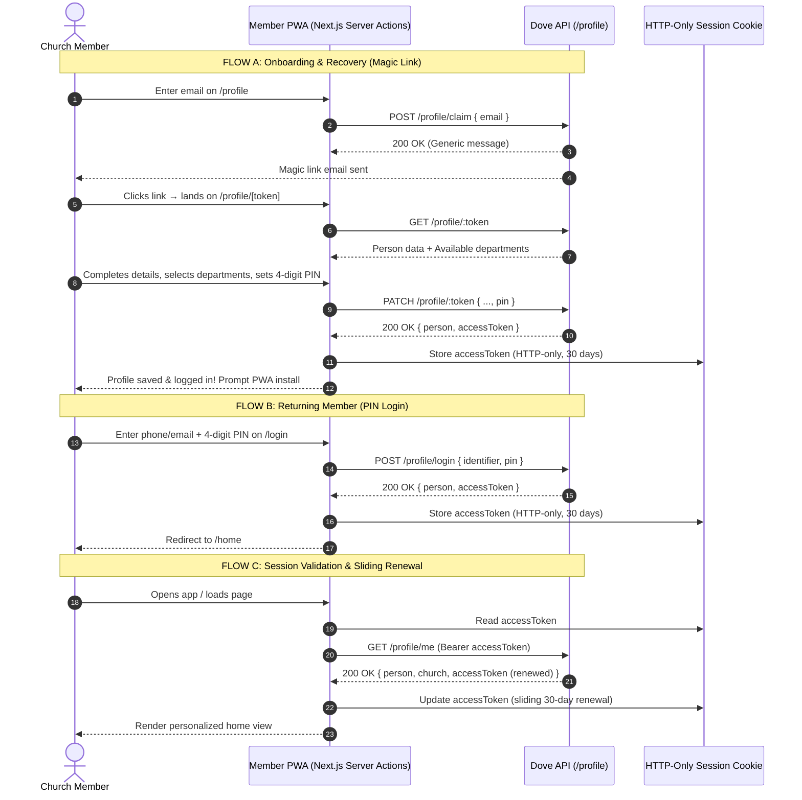

# PWA Frontend Integration Guide — Church Member Relationship Platform (Phase 2 & ADR-007)

This guide provides complete instructions and API contracts for building the **Progressive Web App (PWA)** frontend (`abwog-lifestyle`). It covers the passwordless magic-link onboarding/recovery flow, returning member 4-digit PIN authentication, sliding session management via Next.js Server Actions, in-app PIN updates, and logout.

---

## 1. Architectural Overview & Security



### Key Security & Session Principles

- **Separation of Staff and Member Auth**:
  - Staff credentials (`POST /auth/login`) issue JWT tokens with `user` payload and system roles (`SUPER_ADMIN`, `PASTOR`, etc.).
  - Members authenticate via PIN (`POST /profile/login`) or magic link onboarding (`PATCH /profile/:token`). Member tokens contain `{ sub: personId, churchId, type: 'member', jti }`.
  - Member tokens are strictly rejected by staff endpoints, and staff tokens cannot access member profile endpoints.
- **Token Storage**:
  - The member `accessToken` **must never be exposed to browser JavaScript**.
  - All calls to Dove are executed server-side via Next.js Server Actions / Route Handlers.
  - The token is persisted in a secure, `httpOnly`, `sameSite: 'lax'`, `secure: true` cookie.
- **30-Day Sliding Sessions**:
  - Access tokens have a 30-day lifetime (`exp: 30 days`).
  - Calling `GET /profile/me` validates the active session and returns a freshly signed 30-day `accessToken` in the response body.
  - The Next.js server action updates the HTTP-only cookie with this new token, ensuring active members who visit weekly or monthly stay continuously logged in.
- **Abuse Protection & Rate Limiting**:
  - `POST /profile/claim`: Throttled to 1 request per email per 60s, 5 per hour, and 60 requests per 10 minutes per IP.
  - `POST /profile/login`: Throttled per IP (5 attempts per minute) via NestJS Throttler.
  - **Account Lockout**: 5 consecutive incorrect PIN attempts trigger a **15-minute account lockout** (`PIN_LOCKED`, HTTP 403).
- **Single-Use Onboarding Tokens**:
  - Magic link tokens are single-use and expire 30 minutes after issuance. Once `PATCH /profile/:token` completes, the token is invalidated immediately.

---

## 2. PIN Validation & Weak-PIN Denylist

Both onboarding (`PATCH /profile/:token` with `pin`) and in-app PIN update (`PUT /profile/me/pin` with `newPin`) enforce a strict weak-PIN denylist on Dove:

### Rules Enforced:
1. **Length and Digits**: Must be exactly 4 numeric digits (`^\d{4}$`).
2. **Repetitive Digits**: Disallows identical digits (e.g., `0000`, `1111`, `2222`, ..., `9999`).
3. **Ascending Runs**: Disallows sequential ascending runs (e.g., `1234`, `2345`, `0123`, `6789`).
4. **Descending Runs**: Disallows sequential descending runs (e.g., `4321`, `5432`, `9876`, `3210`).
5. **Common PINs**: Disallows commonly guessed patterns:
   - `1212`, `1122`, `2580` (keypad vertical column), `0852` (keypad vertical reverse), `1004`, `6969`.

### Error Response (`400 Bad Request`):
```json
{
  "statusCode": 400,
  "message": "PIN is too weak. Avoid repeated digits, sequential numbers, or common patterns.",
  "code": "PIN_TOO_WEAK"
}
```

> [!TIP]
> The PWA should validate these rules client-side for immediate user feedback before submitting the form.

---

## 3. Onboarding & Claim Flow

### 3.1 Requesting a Magic Link (`POST /profile/claim`)

Scanned QR codes or visiting `/profile` allow the member to request an onboarding or recovery magic link.

#### Request Body
```json
{
  "email": "sarah.adeyemi@example.com",
  "churchSlug": "abwog" // Optional: defaults to primary church if omitted
}
```
*Note: Magic links are sent via **email**. If the email does not exist, a new visitor record is created with `namesConfirmed: false`.*

#### Response (`200 OK`)
```json
{
  "statusCode": 200,
  "message": "If an account or record matches this contact, a magic link has been sent."
}
```

---

### 3.2 Loading the Onboarding Profile Form (`GET /profile/:token`)

When the user clicks the magic link in their email, they navigate to `/profile/[token]`.

#### Response (`200 OK`)
```json
{
  "person": {
    "id": "6a96bc8e-d98c-4573-9a3b-28f0fb26e031",
    "firstName": "Sarah",
    "lastName": "Adeyemi",
    "namesConfirmed": true,
    "email": "sarah.adeyemi@example.com",
    "phone": "+2348012345678",
    "gender": "FEMALE",
    "dateOfBirth": "1996-04-12",
    "address": "14 Olive Garden Street",
    "membershipStatus": "WORKER",
    "hasPin": false,
    "departments": [
      {
        "id": "dept-choir-uuid",
        "name": "Choir",
        "description": "Music & worship ministry",
        "role": "Member",
        "joinedAt": "2026-08-10T12:00:00.000Z"
      }
    ]
  },
  "church": {
    "id": "church-uuid",
    "name": "Abiding Word Of Grace Missions",
    "shortName": "Amazing Grace",
    "slug": "abwog",
    "whatsappNumber": "+2348012345678",
    "email": "contact@abwog.org",
    "phone": "+2348000000000"
  },
  "availableDepartments": [
    {
      "id": "dept-choir-uuid",
      "name": "Choir",
      "description": "Music & worship ministry"
    },
    {
      "id": "dept-media-uuid",
      "name": "Media & Tech",
      "description": "Sound engineering, livestreaming, visuals"
    }
  ]
}
```

- When `namesConfirmed` is `false`, leave the name fields blank and greet with "Welcome!".
- When `namesConfirmed` is `true`, pre-fill first and last names.

---

### 3.3 Saving Onboarding Profile & Setting PIN (`PATCH /profile/:token`)

When the member submits their details, they can also provide a 4-digit PIN.

#### Request Body
```json
{
  "firstName": "Sarah",
  "lastName": "Adeyemi",
  "email": "sarah.adeyemi@example.com",
  "phone": "+2348012345678",
  "gender": "FEMALE",
  "dateOfBirth": "1996-04-12",
  "address": "14 Olive Garden Street",
  "membershipStatus": "WORKER",
  "departmentIds": ["dept-choir-uuid"],
  "pin": "2846" // 4-digit string
}
```

#### Response (`200 OK`)
When `pin` is set (or the user already has a PIN):
```json
{
  "statusCode": 200,
  "message": "Profile updated successfully",
  "data": {
    "person": {
      "id": "6a96bc8e-d98c-4573-9a3b-28f0fb26e031",
      "firstName": "Sarah",
      "lastName": "Adeyemi",
      "membershipStatus": "WORKER",
      "hasPin": true,
      "departments": [
        { "id": "dept-choir-uuid", "name": "Choir" }
      ]
    },
    "accessToken": "eyJhbGciOiJIUzI1NiIsInR5cCI6IkpXVCJ9..."
  }
}
```

> [!IMPORTANT]
> If a PIN was configured or existed on the profile, `accessToken` is returned next to `person`. The PWA server action should immediately write this token to the session cookie so the member is signed in without needing to log in again. If no PIN is configured, `accessToken` is omitted.

---

## 4. Returning Member PIN Login (`POST /profile/login`)

Returning members sign in with their phone number or email and 4-digit PIN.

### Endpoint Specifications
- **Method**: `POST`
- **Path**: `/profile/login`
- **Auth**: Public (`@Public()`)
- **Rate Limit**: 5 requests / 60 seconds per IP

### Identifier Normalization
Dove automatically normalizes Nigerian phone numbers:
- Domestic format: `08031234567` or `08012345678`
- E.164 international format: `+2348031234567` or `+2348012345678`
- Both formats match the same underlying person record.

### Request Body
```json
{
  "identifier": "08012345678", // or "+2348012345678" or "sarah.adeyemi@example.com"
  "pin": "2846"
}
```

### Success Response (`200 OK`)
```json
{
  "statusCode": 200,
  "data": {
    "person": {
      "id": "6a96bc8e-d98c-4573-9a3b-28f0fb26e031",
      "firstName": "Sarah",
      "lastName": "Adeyemi",
      "membershipStatus": "WORKER",
      "hasPin": true,
      "departments": [
        { "id": "dept-choir-uuid", "name": "Choir" }
      ]
    },
    "accessToken": "eyJhbGciOiJIUzI1NiIsInR5cCI6IkpXVCJ9..."
  }
}
```

### Error Responses & Shapes

Dove uses an exception filter that surfaces custom error attributes (`code`, `attemptsRemaining`, `lockedUntil`) at the **top level** of the JSON response body. For maximum resilience, the PWA can safely read `res.attemptsRemaining ?? res.data?.attemptsRemaining`.

#### 1. Account Not Found (`401 Unauthorized`)
```json
{
  "statusCode": 401,
  "message": "No account found matching this identifier",
  "code": "INVALID_CREDENTIALS"
}
```

#### 2. No PIN Configured (`401 Unauthorized`)
Member exists in church records but has never set a PIN.
```json
{
  "statusCode": 401,
  "message": "No PIN set. Please claim your profile link via email to set your PIN.",
  "code": "NO_PIN_SET"
}
```
*Frontend action: Prompt the user to request a magic link at `/profile`.*

#### 3. Incorrect PIN (`401 Unauthorized`)
Returns `attemptsRemaining` (out of 5).
```json
{
  "statusCode": 401,
  "message": "Invalid PIN. 3 attempts remaining.",
  "code": "INVALID_PIN",
  "attemptsRemaining": 3
}
```

#### 4. Account Locked (`403 Forbidden`)
Triggered on the 5th incorrect attempt or when attempting login during a lockout. Returns `lockedUntil` as an ISO timestamp (15-minute lock).
```json
{
  "statusCode": 403,
  "message": "Account is temporarily locked due to too many failed attempts. Try again after 2026-11-06T00:45:00.000Z.",
  "code": "PIN_LOCKED",
  "lockedUntil": "2026-11-06T00:45:00.000Z"
}
```
*Frontend action: Disable submit button and show a countdown until `lockedUntil`.*

---

## 5. Session Validation & Sliding Refresh (`GET /profile/me`)

The PWA invokes this endpoint on home-page load or in the root server layout to validate the member session and renew the sliding cookie.

### Endpoint Specifications
- **Method**: `GET`
- **Path**: `/profile/me`
- **Headers**: `Authorization: Bearer <accessToken>`

### Response (`200 OK`)
```json
{
  "person": {
    "id": "6a96bc8e-d98c-4573-9a3b-28f0fb26e031",
    "firstName": "Sarah",
    "lastName": "Adeyemi",
    "email": "sarah.adeyemi@example.com",
    "phone": "+2348012345678",
    "gender": "FEMALE",
    "dateOfBirth": "1996-04-12",
    "address": "14 Olive Garden Street",
    "membershipStatus": "WORKER",
    "hasPin": true,
    "departments": [
      {
        "id": "dept-choir-uuid",
        "name": "Choir",
        "role": "Member"
      }
    ]
  },
  "church": {
    "id": "church-uuid",
    "name": "Abiding Word Of Grace Missions",
    "shortName": "Amazing Grace",
    "slug": "abwog",
    "whatsappNumber": "+2348012345678",
    "email": "contact@abwog.org",
    "phone": "+2348000000000"
  },
  "accessToken": "eyJhbGciOiJIUzI1NiIsInR5cCI6IkpXVCJ9..." // Refreshed sliding token (30 days)
}
```

### Sliding Session Behavior
1. Every successful `GET /profile/me` call issues a fresh 30-day `accessToken` in the response body.
2. The PWA Next.js server action should write this updated `accessToken` into the HTTP-only cookie.
3. If the token is missing, expired, or revoked, Dove returns `401 Unauthorized`. The PWA clears the cookie and redirects to `/login`.

---

## 6. Setting or Changing PIN (`PUT /profile/me/pin`)

Allows an authenticated member to set a PIN for the first time or update their existing PIN without requesting a magic link.

### Endpoint Specifications
- **Method**: `PUT`
- **Path**: `/profile/me/pin`
- **Headers**: `Authorization: Bearer <accessToken>`

### Request Body
```json
{
  "currentPin": "2846", // Required if person.hasPin is true; optional if hasPin is false
  "newPin": "8137"      // 4 numeric digits, checked against weak PIN denylist
}
```

### Response (`200 OK`)
```json
{
  "statusCode": 200,
  "message": "PIN updated successfully"
}
```

### Error Conditions
- **Missing `currentPin` when PIN is set (`400 Bad Request`)**:
  ```json
  {
    "statusCode": 400,
    "message": "Current PIN is required to change your PIN",
    "code": "CURRENT_PIN_REQUIRED"
  }
  ```
- **Incorrect `currentPin` (`401 Unauthorized`)**:
  Counts toward the 5-attempt lockout.
  ```json
  {
    "statusCode": 401,
    "message": "Invalid current PIN. 2 attempts remaining.",
    "code": "INVALID_PIN",
    "attemptsRemaining": 2
  }
  ```
- **Account Locked (`403 Forbidden`)**:
  ```json
  {
    "statusCode": 403,
    "message": "Account is temporarily locked due to too many failed attempts. Try again after ...",
    "code": "PIN_LOCKED",
    "lockedUntil": "2026-11-06T00:50:00.000Z"
  }
  ```
- **Weak New PIN (`400 Bad Request`)**:
  ```json
  {
    "statusCode": 400,
    "message": "PIN is too weak. Avoid repeated digits, sequential numbers, or common patterns.",
    "code": "PIN_TOO_WEAK"
  }
  ```

---

## 7. Session Revocation / Logout (`POST /profile/logout`)

Revokes the member's active session token server-side.

### Endpoint Specifications
- **Method**: `POST`
- **Path**: `/profile/logout`
- **Headers**: `Authorization: Bearer <accessToken>`

### Response (`200 OK`)
```json
{
  "statusCode": 200,
  "message": "Logged out successfully"
}
```

### Post-Logout Action
The Next.js server action should delete the session cookie and redirect the user to `/login`.

---

## 8. Next.js Server Action Reference Implementation

The following example demonstrates managing the HTTP-only member session in Next.js (App Router):

```typescript
// app/actions/auth.ts
'use server';

import { cookies } from 'next/headers';
import { redirect } from 'next/navigation';

const DOVE_API_URL = process.env.DOVE_API_URL || 'http://localhost:3000';
const COOKIE_NAME = 'dove_member_session';
const COOKIE_MAX_AGE = 30 * 24 * 60 * 60; // 30 days in seconds

/**
 * Helper to get the auth cookie
 */
async function getSessionToken(): Promise<string | undefined> {
  const cookieStore = await cookies();
  return cookieStore.get(COOKIE_NAME)?.value;
}

/**
 * Helper to set or update the sliding auth cookie
 */
async function setSessionCookie(token: string) {
  const cookieStore = await cookies();
  cookieStore.set(COOKIE_NAME, token, {
    httpOnly: true,
    secure: process.env.NODE_ENV === 'production',
    sameSite: 'lax',
    path: '/',
    maxAge: COOKIE_MAX_AGE,
  });
}

/**
 * 1. PIN Login Action
 */
export async function loginWithPin(identifier: string, pin: string) {
  const res = await fetch(`${DOVE_API_URL}/profile/login`, {
    method: 'POST',
    headers: { 'Content-Type': 'application/json' },
    body: JSON.stringify({ identifier, pin }),
  });

  const body = await res.json();

  if (!res.ok) {
    return {
      success: false,
      code: body.code || 'UNKNOWN_ERROR',
      message: body.message,
      attemptsRemaining: body.attemptsRemaining ?? body.data?.attemptsRemaining,
      lockedUntil: body.lockedUntil ?? body.data?.lockedUntil,
    };
  }

  const { person, accessToken } = body.data || body;
  await setSessionCookie(accessToken);

  return { success: true, person };
}

/**
 * 2. Validate Session on App Load (with Sliding Renewal)
 */
export async function validateSession() {
  const token = await getSessionToken();
  if (!token) return null;

  try {
    const res = await fetch(`${DOVE_API_URL}/profile/me`, {
      headers: { Authorization: `Bearer ${token}` },
      cache: 'no-store',
    });

    if (!res.ok) {
      await logoutMember();
      return null;
    }

    const data = await res.json();
    const result = data.data || data;

    // Slide the session if renewed token is returned
    if (result.accessToken) {
      await setSessionCookie(result.accessToken);
    }

    return { person: result.person, church: result.church };
  } catch {
    return null;
  }
}

/**
 * 3. Change PIN Action
 */
export async function changePin(currentPin: string | undefined, newPin: string) {
  const token = await getSessionToken();
  if (!token) return { success: false, code: 'UNAUTHORIZED' };

  const res = await fetch(`${DOVE_API_URL}/profile/me/pin`, {
    method: 'PUT',
    headers: {
      'Content-Type': 'application/json',
      Authorization: `Bearer ${token}`,
    },
    body: JSON.stringify({ currentPin, newPin }),
  });

  const body = await res.json();
  if (!res.ok) {
    return {
      success: false,
      code: body.code,
      message: body.message,
      attemptsRemaining: body.attemptsRemaining,
      lockedUntil: body.lockedUntil,
    };
  }

  return { success: true, message: body.message };
}

/**
 * 4. Logout Action
 */
export async function logoutMember() {
  const token = await getSessionToken();
  if (token) {
    try {
      await fetch(`${DOVE_API_URL}/profile/logout`, {
        method: 'POST',
        headers: { Authorization: `Bearer ${token}` },
      });
    } catch {
      // Continue clearing cookie even if backend call fails
    }
  }

  const cookieStore = await cookies();
  cookieStore.delete(COOKIE_NAME);
  redirect('/login');
}
```

---

## 9. TypeScript Types & Error Codes

```typescript
// types/member-session.ts

export type Gender = 'MALE' | 'FEMALE' | 'OTHER';

export type MembershipStatus =
  | 'VISITOR'
  | 'MEMBER'
  | 'WORKER'
  | 'LEADER'
  | 'PASTOR';

export interface DepartmentSummary {
  id: string;
  name: string;
  description?: string | null;
  role?: string | null;
  joinedAt?: string;
}

export interface MemberPerson {
  id: string;
  firstName: string;
  lastName: string;
  namesConfirmed: boolean;
  email: string | null;
  phone: string | null;
  gender: Gender | null;
  dateOfBirth: string | null;
  address: string | null;
  membershipStatus: MembershipStatus;
  hasPin: boolean;
  departments: DepartmentSummary[];
}

export interface ChurchSummary {
  id: string;
  name: string;
  shortName?: string | null;
  slug: string;
  whatsappNumber?: string | null;
  email?: string | null;
  phone?: string | null;
}

export interface MemberSessionData {
  person: MemberPerson;
  church: ChurchSummary;
  accessToken: string;
}

export type ProfileErrorCode =
  | 'PROFILE_LINK_EXPIRED'
  | 'PROFILE_LINK_INVALID'
  | 'NAMES_REQUIRED'
  | 'DEPARTMENT_REQUIRED'
  | 'PIN_TOO_WEAK'
  | 'INVALID_CREDENTIALS'
  | 'NO_PIN_SET'
  | 'INVALID_PIN'
  | 'PIN_LOCKED'
  | 'CURRENT_PIN_REQUIRED';

export interface ApiErrorResponse {
  statusCode: number;
  message: string;
  code: ProfileErrorCode;
  attemptsRemaining?: number;
  lockedUntil?: string;
}
```

---

## 10. Summary Checklist for Frontend Implementation

- [ ] **Onboarding Form (`PATCH /profile/:token`)**:
  - Add optional 4-digit PIN input with client-side strength checks.
  - Read `accessToken` from response and store it into the HTTP-only cookie.
- [ ] **Returning Member Login (`POST /profile/login`)**:
  - Allow entering phone (`0803...` or `+234803...`) or email.
  - Handle `NO_PIN_SET` by guiding the user to request a magic link.
  - Handle `INVALID_PIN` and display `attemptsRemaining`.
  - Handle `PIN_LOCKED` and display countdown timer using `lockedUntil`.
- [ ] **Home / Root Layout (`GET /profile/me`)**:
  - Send Bearer token from HTTP-only cookie.
  - Update session cookie with renewed `accessToken` from the response (sliding session).
- [ ] **Settings / Security (`PUT /profile/me/pin`)**:
  - Require `currentPin` if `person.hasPin` is true.
  - Display `attemptsRemaining` or `lockedUntil` on errors.
- [ ] **Sign Out (`POST /profile/logout`)**:
  - Call revocation endpoint and delete cookie.

---

## 11. Family Connections & Relative Management

### 11.1 Identity & Data Model Principles
- **Separate Identity**: Every individual is an independent `Person` in Dove. Adding a relative does **not** create a dependent or sub-profile.
- **Unique Contacts**: Each person must have their own unique email and/or phone number. Sharing contact details with a family member is rejected.
- **Ownership**: The member who created a relative's profile **cannot edit** that relative's details after creation. Only the relative themselves can edit their profile once they claim it.
- **Unlinking**: Deleting a relationship removes only the link between the two people; it never deletes the relative's person record.

### 11.2 Adding a Relative (`POST /profile/me/relatives`)
Available on `/profile/family` or `/settings/family`.

#### Form Fields:
- `firstName`: string (required)
- `lastName`: string (required)
- `relationship`: `'SPOUSE' | 'PARENT' | 'CHILD' | 'SIBLING' | 'OTHER'` (required)
- `relationshipNote`: string (optional, up to 100 chars, e.g. "Cousin" or "Guardian" when `OTHER`)
- `email`: string (optional)
- `phone`: string (optional)
- `gender`: `'MALE' | 'FEMALE' | 'OTHER'` (optional)
- `dateOfBirth`: `'YYYY-MM-DD'` (optional)

> [!IMPORTANT]
> At least one contact detail (`email` or `phone`) is required. If neither is provided, Dove returns `400` with code `CONTACT_REQUIRED`.

#### Handling Taken Contact Details:
If the entered email or phone is already taken by another person in the church, Dove returns `409 Conflict`:
```json
{
  "statusCode": 409,
  "message": "This email or phone number is already registered.",
  "code": "CONTACT_ALREADY_REGISTERED"
}
```
Display the generic message directly under the form. Do not reveal which field matched.

#### Rate Limit:
Each member may create up to 10 relatives per day. Exceeding this returns `429 Too Many Requests`.

---

### 11.3 Viewing Family Links (`GET /profile/me/relatives`)
Returns the list of relatives connected to the authenticated member in both directions:
```typescript
export interface RelativeItem {
  relationshipId: string;
  person: {
    id: string;
    firstName: string;
    lastName: string;
  };
  relationship: 'SPOUSE' | 'PARENT' | 'CHILD' | 'SIBLING' | 'OTHER';
  relationshipNote?: string | null;
  addedByMe: boolean;
  claimed: boolean;
  maskedEmail?: string | null; // e.g. "t***@example.com"
  maskedPhone?: string | null; // e.g. "•••• ••• 7890"
  canSendClaimLink: boolean;
}
```
- Relationship types are automatically inverted when viewing incoming links (`PARENT` is shown as `CHILD`, and `CHILD` is shown as `PARENT`).
- `claimed` indicates the relative has claimed their profile and set a PIN.
- Relative records are read-only for the creator; no edit endpoint exists for members.

---

### 11.4 Inviting Phone-Only Relatives via WhatsApp (`POST /profile/me/relatives/:personId/claim-link`)
When `canSendClaimLink` is `true` (`addedByMe` is true, the relative has not claimed their profile yet, and they have a phone number), the UI shows a **"Send Invite via WhatsApp"** button.

#### Calling the Server Action:
```typescript
// server-actions/family.ts
export async function sendRelativeClaimLink(personId: string) {
  const token = await getSessionToken();
  const res = await fetch(`${DOVE_API_URL}/profile/me/relatives/${personId}/claim-link`, {
    method: 'POST',
    headers: { Authorization: `Bearer ${token}` },
  });
  const data = await res.json();
  if (!res.ok) throw new Error(data.message || 'Failed to generate claim link');
  return data; // { url, whatsappUrl, expiresAt }
}
```
- The backend generates a **48-hour single-use onboarding token**.
- The response returns `whatsappUrl` (pre-filled `https://wa.me/<digits>?text=...`).
- The PWA opens `whatsappUrl` in a new tab / WhatsApp app so the member can message their relative directly.
- Rate limit: 3 claim links per day per target relative (`429`).
- Errors: `403` `NOT_CREATOR`, `409` `ALREADY_CLAIMED`, `409` `NO_PHONE`.

---

### 11.5 Removing a Family Link (`DELETE /profile/me/relatives/:relationshipId`)
Either person in the link can remove the relationship.
- Provide a confirmation modal: *"Remove [Name] from your family links? This will disconnect the relationship, but will not delete their church profile."*
- Calls `DELETE /profile/me/relatives/:relationshipId`.
- Updates the list upon success.

