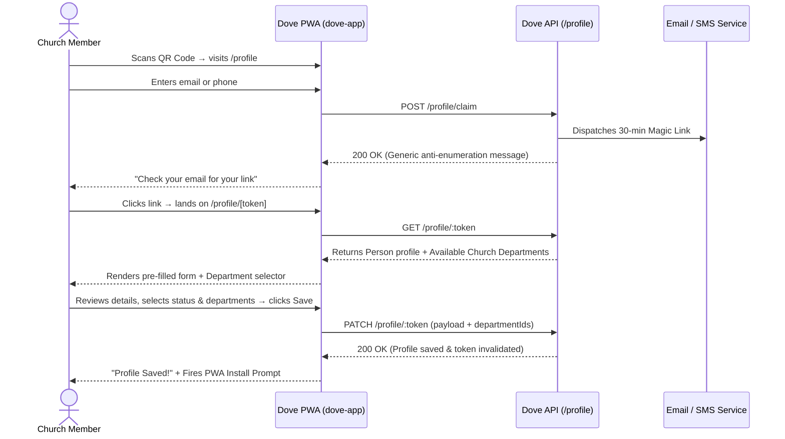

# PWA Frontend Integration Guide — Church Member Relationship Platform (Phase 2)

This guide provides everything needed to build the **Progressive Web App (PWA)** frontend (`dove-app`). It covers the passwordless magic link claim flow, profile setup, department self-selection, and the post-save PWA installation prompt.

---

## 1. Architectural Overview & Security



### Key Security Features
- **Public Endpoints**: All `/profile` routes are unauthenticated (`@Public()`). No Bearer JWT headers are required for member onboarding.
- **Single-Use Tokens**: The magic link token is strictly single-use and expires after 30 minutes. Once `PATCH /profile/:token` succeeds, the token is destroyed.
- **Anti-Enumeration**: `POST /profile/claim` always returns HTTP 200 with the same confirmation message regardless of whether the email or phone was previously registered.
- **Role Isolation**: Selecting `LEADER` or `PASTOR` updates directory categorization only; it does **not** grant system administrative access.

---

## 2. Screen 1: Magic Link Claim (`/profile`)

The public entry point when someone scans the church QR code or clicks the shared link.

### Endpoint: `POST /profile/claim`

#### Request Body
```json
{
  "email": "sarah.johnson@example.com",
  "phone": "+2348012345678",
  "churchSlug": "abwog" // Optional: defaults to primary church if omitted
}
```
*Note: At least one of `email` or `phone` is required.*

#### Response (`200 OK`)
```json
{
  "statusCode": 200,
  "message": "If an account or record matches this contact, a magic link has been sent."
}
```

#### Frontend Implementation Notes
1. **Form Fields**: Simple form with Email and/or Phone number input.
2. **Success State**: Always transition to a *"Check your inbox"* screen with instructions to click the secure link sent to their email.
3. **Resend Timer**: Provide a 60-second cooldown timer before allowing the user to click "Resend link" to prevent spamming.

---

## 3. Screen 2: Pre-filled Profile & Departments (`/profile/[token]`)

When the member clicks the link in their email, they land on `/profile/[token]`.

### Endpoint: `GET /profile/:token`

#### Fetching Data on Mount
Call `GET /profile/:token` once. The backend provides everything needed for the form in a single request:
1. The person's existing profile
2. Their currently assigned departments
3. The church's complete list of `availableDepartments` for dropdown selection

#### Response (`200 OK`)
```json
{
  "person": {
    "id": "6a96bc8e-d98c-4573-9a3b-28f0fb26e031",
    "firstName": "Sarah",
    "lastName": "Johnson",
    "email": "sarah.johnson@example.com",
    "phone": "+2348012345678",
    "gender": "FEMALE",
    "dateOfBirth": "1996-04-12",
    "address": "14 Olive Garden Street",
    "membershipStatus": "WORKER",
    "departments": [
      {
        "id": "dept-choir-uuid",
        "name": "Choir",
        "description": "Music & worship ministry",
        "role": "Member",
        "joinedAt": "2026-08-10T12:00:00.000Z"
      }
    ]
  },
  "church": {
    "id": "church-uuid",
    "name": "Amazing Grace Bible Church",
    "slug": "abwog",
    "email": "contact@abwog.org",
    "phone": "+2348000000000"
  },
  "availableDepartments": [
    {
      "id": "dept-choir-uuid",
      "name": "Choir",
      "description": "Music & worship ministry"
    },
    {
      "id": "dept-media-uuid",
      "name": "Media & Tech",
      "description": "Sound engineering, livestreaming, visuals"
    },
    {
      "id": "dept-ushers-uuid",
      "name": "Ushers & Protocol",
      "description": "Hospitality and sanctuary management"
    },
    {
      "id": "dept-children-uuid",
      "name": "Children's Ministry",
      "description": "Teaching and nurturing church children"
    }
  ]
}
```

#### Token Error Handling
If the token is invalid or expired, the backend returns `400 Bad Request`:
- **Expired**: `message: "Magic link has expired. Please request a new one."`
  → Render an expired link view with a *"Request a new link"* button redirecting back to `/profile`.
- **Invalid**: `message: "Invalid or expired magic link"`
  → Render an invalid link view.

---

## 4. Screen 3: Form Rendering & Conditional Logic

### Form Fields
1. **First Name & Last Name** (Required text inputs)
2. **Email Address** (Optional/pre-filled)
3. **Phone Number** (Optional/pre-filled)
4. **Gender** (Radio group or Select: `MALE`, `FEMALE`, `OTHER`)
5. **Date of Birth** (Date picker input: `YYYY-MM-DD`)
6. **Address** (Textarea or single-line address)
7. **Membership Status** (Select dropdown):
   - `VISITOR` — First-time or occasional guest
   - `MEMBER` — Regular congregation member
   - `WORKER` — Serves in a church ministry/department
   - `LEADER` — Department head, cell leader, or elder
   - `PASTOR` — Ordained minister or pastoral staff

### Dynamic Department Field Behavior
The department selector should dynamically respond to the selected `membershipStatus`:

| Selected Status | Department Selector Behavior |
|---|---|
| **`WORKER`** | **Required/Highlighted**: Show multi-select tags/checkboxes populated from `availableDepartments`. Prompt: *"Which department(s) do you serve in?"* |
| **`LEADER` / `PASTOR`** | **Optional**: Show department multi-select with helper note: *"Select any operational departments you preside over or serve in (optional)."* |
| **`VISITOR` / `MEMBER`** | **Hidden or Collapsed**: Typically 0 departments. |

---

## 5. Screen 4: Saving Profile & Invalidation

### Endpoint: `PATCH /profile/:token`

When the user clicks **"Save & Continue"**, send the form data:

#### Request Body
```json
{
  "firstName": "Sarah",
  "lastName": "Johnson",
  "email": "sarah.johnson@example.com",
  "phone": "+2348012345678",
  "gender": "FEMALE",
  "dateOfBirth": "1996-04-12",
  "address": "14 Olive Garden Street",
  "membershipStatus": "WORKER",
  "departmentIds": [
    "dept-choir-uuid",
    "dept-media-uuid"
  ]
}
```

#### Response (`200 OK`)
```json
{
  "statusCode": 200,
  "message": "Profile updated successfully",
  "data": {
    "person": {
      "id": "6a96bc8e-d98c-4573-9a3b-28f0fb26e031",
      "firstName": "Sarah",
      "lastName": "Johnson",
      "membershipStatus": "WORKER",
      "departments": [
        { "id": "dept-choir-uuid", "name": "Choir" },
        { "id": "dept-media-uuid", "name": "Media & Tech" }
      ]
    }
  }
}
```

> [!IMPORTANT]
> The backend automatically invalidates the token upon receiving a successful `PATCH`. Attempting to call the endpoint again with the same token will fail with a 400 error.

---

## 6. Screen 5: PWA Installation Prompt (The On-Ramp)

Never prompt users to install the PWA on their first visit. The highest install conversion occurs **immediately after the member successfully saves their profile**.

### Capturing the Install Event (React / Next.js Hook)

```typescript
// usePwaInstall.ts
import { useState, useEffect } from 'react';

interface BeforeInstallPromptEvent extends Event {
  prompt: () => Promise<void>;
  userChoice: Promise<{ outcome: 'accepted' | 'dismissed' }>;
}

export function usePwaInstall() {
  const [promptEvent, setPromptEvent] = useState<BeforeInstallPromptEvent | null>(null);
  const [isInstallable, setIsInstallable] = useState(false);

  useEffect(() => {
    const handler = (e: Event) => {
      e.preventDefault();
      setPromptEvent(e as BeforeInstallPromptEvent);
      setIsInstallable(true);
    };

    window.addEventListener('beforeinstallprompt', handler);
    return () => window.removeEventListener('beforeinstallprompt', handler);
  }, []);

  const triggerInstall = async () => {
    if (!promptEvent) return false;
    await promptEvent.prompt();
    const choice = await promptEvent.userChoice;
    setPromptEvent(null);
    setIsInstallable(false);
    return choice.outcome === 'accepted';
  };

  return { isInstallable, triggerInstall };
}
```

### Success Screen Component

```tsx
// ProfileSuccessView.tsx
export function ProfileSuccessView({ churchName, onInstallClick, isInstallable }: Props) {
  return (
    <div className="max-w-md mx-auto text-center p-6 space-y-6">
      <div className="w-16 h-16 bg-green-100 text-green-600 rounded-full flex items-center justify-center mx-auto text-2xl">
        ✓
      </div>

      <h1 className="text-2xl font-bold">Profile Saved!</h1>
      <p className="text-gray-600">
        Thank you for keeping your details updated with {churchName}.
      </p>

      {/* PWA Install Card */}
      <div className="bg-blue-50 border border-blue-200 rounded-xl p-5 text-left space-y-3">
        <h3 className="font-semibold text-blue-900">Stay Connected</h3>
        <p className="text-sm text-blue-700">
          Install the Dove Church app to your home screen for church updates, devotionals, and events.
        </p>

        {isInstallable ? (
          <button
            onClick={onInstallClick}
            className="w-full bg-blue-600 text-white font-medium py-2.5 px-4 rounded-lg hover:bg-blue-700 transition"
          >
            Install Dove App
          </button>
        ) : (
          <p className="text-xs text-gray-500 italic">
            Tip on iOS: Tap the <strong>Share</strong> button below and select <strong>Add to Home Screen</strong>.
          </p>
        )}
      </div>
    </div>
  );
}
```

---

## 7. TypeScript Type Definitions

```typescript
// types/profile.ts

export type Gender = 'MALE' | 'FEMALE' | 'OTHER';

export type MembershipStatus =
  | 'VISITOR'
  | 'MEMBER'
  | 'WORKER'
  | 'LEADER'
  | 'PASTOR';

export interface DepartmentInfo {
  id: string;
  name: string;
  description?: string | null;
  role?: string | null;
  joinedAt?: string;
}

export interface PersonProfile {
  id: string;
  firstName: string;
  lastName: string;
  email: string | null;
  phone: string | null;
  gender: Gender | null;
  dateOfBirth: string | null; // "YYYY-MM-DD"
  address: string | null;
  membershipStatus: MembershipStatus;
  departments: DepartmentInfo[];
}

export interface ChurchInfo {
  id: string;
  name: string;
  slug: string;
  email?: string | null;
  phone?: string | null;
  branchName?: string | null;
  campusName?: string | null;
}

export interface ProfileBootstrapResponse {
  person: PersonProfile;
  church: ChurchInfo;
  availableDepartments: DepartmentInfo[];
}

export interface UpdateProfilePayload {
  firstName?: string;
  lastName?: string;
  email?: string;
  phone?: string;
  gender?: Gender;
  dateOfBirth?: string;
  address?: string;
  membershipStatus?: MembershipStatus;
  departmentIds?: string[];
}
```
